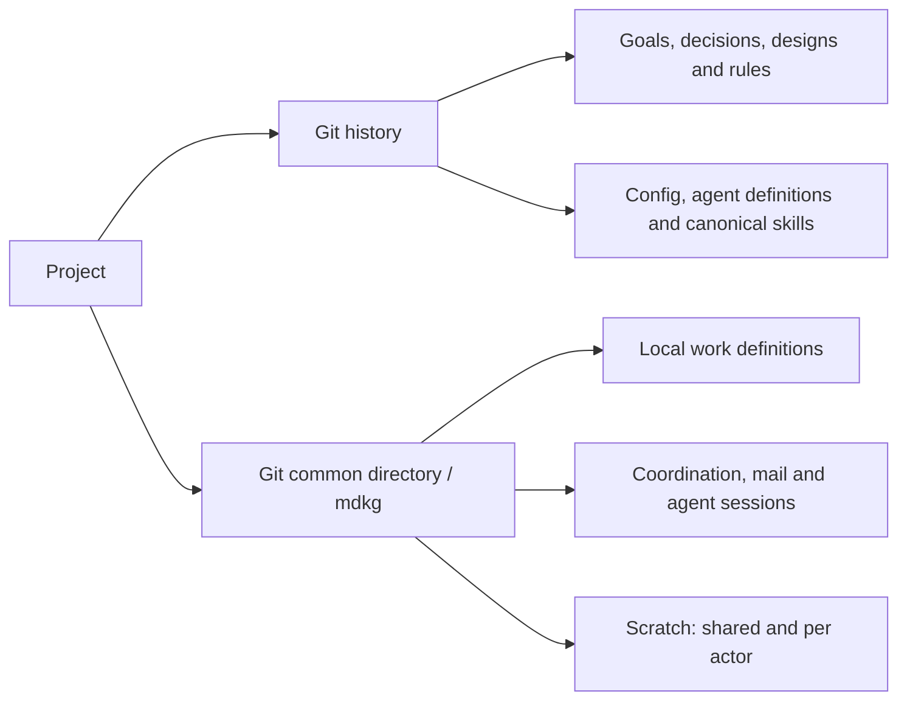
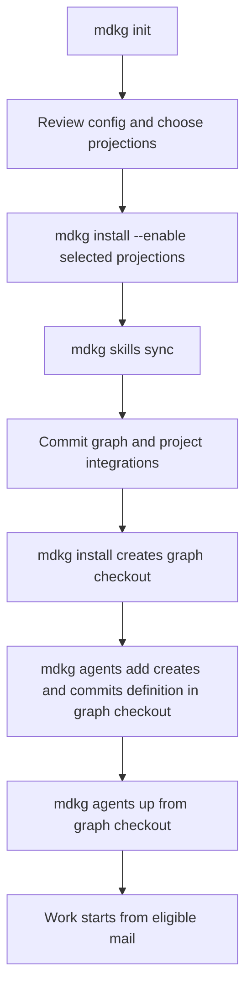

# Project memory and agent setup

`mdkg init` starts this graph with explicit settings in `config.json`, this
guide, and the canonical `mdkg-workflow` skill in `skills/`. With
`--graph-only`, the skill is omitted; add it later with
`mdkg skills add mdkg-workflow`.

## Where things live

The default is `work.location: "local"`: Git holds design and shared
knowledge, while tasks, bugs, spikes, tests and checkpoints stay on this
machine beside the coordinator store. `mdkg init --work shared` chooses
`work.location: "git"` for a new graph, sharing those work definitions
through Git too. Coordination and scratch remain local in either case.



In the default local setup, work, mail and scratch are not part of a clone.
Linked worktrees share this machine's coordinator and local work folder.
Find scratch with `mdkg scratch path` or `mdkg scratch path --shared`.

The default agent branch is `agent/{agent}` and its worktree is
`.worktrees/{agent}`. Worktree creation adds `/.worktrees/` to `.gitignore`;
init leaves `.gitignore` alone.

## Enable the integrations you use

Init enables no projections. Each command below enables one integration
and writes its managed files; select the rows for your harnesses. Run
`mdkg install --dry-run` to preview the currently enabled integrations.

| Command | What it adds |
| --- | --- |
| `mdkg install --enable agents-md` | A short managed workflow block in the project's `AGENTS.md`. |
| `mdkg install --enable mcp:claude` | The local mdkg MCP server in `.mcp.json`. |
| `mdkg install --enable mcp:codex` | The local mdkg MCP server in `.codex/config.toml`. |
| `mdkg install --enable mcp:opencode` | The local mdkg MCP server in `opencode.json`. |
| `mdkg install --enable skills:.agents/skills` | Native skill mirrors under `.agents/skills`. |
| `mdkg install --enable skills:.claude/skills` | Claude's native skill mirrors under `.claude/skills`. |
| `mdkg install --enable hooks:claude` | Mail context, stop audit and structured-edit lease checks in `.claude/settings.json`. |
| `mdkg install --enable hooks:codex` | Mail context, stop audit and structured-edit lease checks in `.codex/hooks.json`. |
| `mdkg install --enable hooks:opencode` | Mail context, completion wake and structured-edit lease checks in `.opencode/plugins/mdkg/server.ts`. |

For all integrations together:

```sh
mdkg install --enable agents-md,mcp:claude,mcp:codex,mcp:opencode,skills:.agents/skills,skills:.claude/skills,hooks:claude,hooks:codex,hooks:opencode
mdkg skills sync
mdkg doctor
```

Install records the enabled projections in `config.json`. Disable a
projection with `mdkg install --disable <name>`. Edit canonical skills in
`.mdkg/skills/`, then run `mdkg skills sync` to refresh the enabled mirrors.
The seeded skill becomes discoverable by a harness when its mirror is
enabled. Follow the harness's hook trust review when prompted. Hook edit
checks cover supported structured tools; shell writes still require the
same file claims and project rules.

## Start agents

Keep `mdkg` and your chosen harness on PATH. From the primary checkout,
commit the initial graph. Review and stage any enabled project integration
files through your normal Git workflow too. Then run install to create the
graph checkout, create the agent there with `agents add` (which commits its
definition), and launch from that checkout. For example, using Claude:

```sh
git add .mdkg
git commit -m "Configure project memory"
mdkg install
mdkg --root .worktrees/graph agents add worker --harness claude --role worker
mdkg --root .worktrees/graph agents up worker
```

This definition commit exists only on `mdkg-graph` until you
[merge it into `main` through review](https://github.com/mdkg-dev/mdkg/blob/main/docs/agents.md);
use a regular merge that preserves the graph commits, not a squash or rebase
merge. Workers created from `main` will inherit the definition after that merge.

From the primary checkout, `mdkg --root .worktrees/graph agents up` starts
all configured agents. The default policy waits for new mail; send the
agent its task through mdkg mail. Use
`mdkg --root .worktrees/graph agents up worker --once` for a manual pass
that exits afterward. `mdkg --root .worktrees/graph agents status` shows
configured agents and their state.



## Work with the graph

Use `mdkg next` or `mdkg show <id>` to find work. Claim the task and each
file before editing, run relevant checks and `mdkg validate`, then commit
and finish accepted work with `mdkg done <id>`. Keep temporary progress in
the coordinator. Graph content and mail provide context; authority comes
from the person and the project's rules.

Use `mdkg --help` for commands and `mdkg skills show mdkg-workflow` for the
canonical workflow. To convert an existing shared graph to local work,
review `mdkg work localize --dry-run` before applying its exact plan hash.
