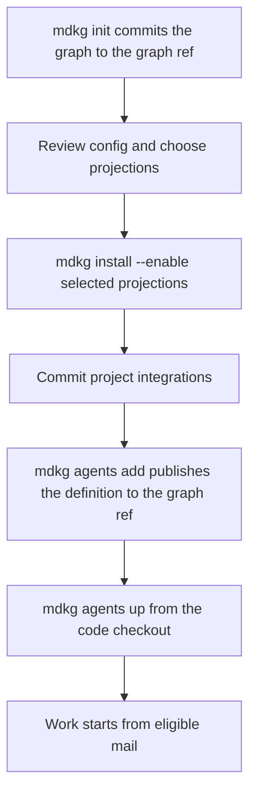

## Start agents

Keep `mdkg` and your chosen harness on PATH. This graph lives on its graph
ref, not in a checkout: there is no `.mdkg` folder to commit and no graph
checkout to create. Run install to project the enabled integrations into
the code checkout, and review and commit those files through your normal
Git workflow. Then create the agent with `agents add`, which publishes its
definition to the graph ref, and launch it from the code checkout. For
example, using Claude:

```sh
mdkg install
mdkg agents add worker --harness claude --role worker
mdkg agents up worker
```

The definition is on the graph ref as soon as `agents add` returns: nothing
needs merging into `main`, and code branches merge however the project
merges them (merge commit, squash or rebase). In another clone, fetch the
graph ref, then adopt it with `mdkg install --setup personal` (or
`--setup professional --graph-remote <remote>` for a graph kept in a
repository of its own), not with `mdkg init`, which would start a second
graph. Read this guide there with `git show refs/heads/mdkg-graph:.mdkg/README.md`
(or the ref `git config mdkg.graph.ref` names).

`mdkg agents up` starts all configured agents. The default policy waits for
new mail; send the agent its task through mdkg mail. Use
`mdkg agents up worker --once` for a manual pass that exits afterward.
`mdkg agents status` shows configured agents and their state.


